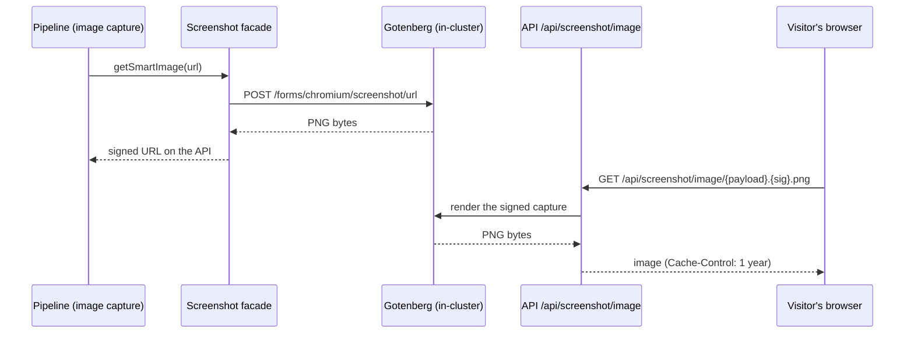

# Gotenberg Plugin

The Gotenberg plugin is the **default screenshot provider** of Ever Works. It captures website screenshots with a self-hosted [Gotenberg](https://gotenberg.dev) server — an open-source (MIT) document and screenshot API built on Chromium — so preview images for work items need no third-party account and cost nothing per screenshot.

The paid SaaS providers stay available as opt-in alternatives: [ScreenshotOne](./screenshotone-plugin.md) and [Urlbox](./urlbox-plugin.md).

**Source:** `packages/plugins/gotenberg/src/gotenberg.plugin.ts`

## Overview

| Property                 | Value                         |
| ------------------------ | ----------------------------- |
| Plugin ID                | `gotenberg`                   |
| Category                 | `screenshot`                  |
| Capabilities             | `screenshot`                  |
| Default for capabilities | `screenshot`                  |
| Configuration Mode       | `admin-only`                  |
| Auto-enable              | Yes                           |
| Built-in / System Plugin | Yes / Yes                     |
| Dependencies             | none (Node's `fetch`)         |
| Server                   | Gotenberg 8 or 9 (`chromium`) |

## Why Gotenberg

| Candidate                     | License               | Why (not)                                                                                                                                       |
| ----------------------------- | --------------------- | ----------------------------------------------------------------------------------------------------------------------------------------------- |
| **Gotenberg**                 | MIT                   | ~13.6k stars, releases every few days, one stateless container, a stable multipart HTTP API, and a pinning proxy that refuses private addresses |
| Browserless                   | SSPL-1.0 / commercial | Popular, but the SSPL and the commercial licence make it unsuitable as the default of an AGPL platform offered as a service                     |
| Playwright/Puppeteer wrappers | various               | Small projects (hundreds of stars at most) with irregular releases                                                                              |

## How it works



1. During generation, the facade asks Gotenberg for the screenshot. A failure (site down, blocked target, timeout) means the item gets no image.
2. Gotenberg answers image **bytes**, not a URL. A Work item keeps a URL, so the facade mints a **signed URL on the platform's own API**: `{SCREENSHOT_IMAGE_BASE_URL}/api/screenshot/image/{payload}.{signature}.{ext}`. The payload names the provider and the capture options; the signature is an HMAC over it.
3. The public route renders exactly what was signed — nobody can make the cluster's browser open a URL of their choice — and answers with `Cache-Control: public, max-age=31536000, immutable`, so a CDN in front of the API renders each image once.

Without `SCREENSHOT_IMAGE_BASE_URL` the capture still happens but items get no image, as before. The API's own capture endpoint (`POST /api/screenshot/capture`) returns the image as base64 either way.

Good to know:

- **Snapshots.** A URL always means the same capture, so it is cached as immutable. When the CDN evicts it, the next request renders the page as it is _then_; there is no way to refresh one sooner (the same holds for ScreenshotOne's cached render URLs).
- **Abuse.** The route is public but renders only signed URLs, never a private or non-HTTP(S) target (checked when minting and again when rendering). A query string bypasses the CDN, so each API process also caches renders for 10 minutes (failures for 1), shares one render among concurrent requests, and the route is throttled per client. Gotenberg itself caps concurrent renders per pod (`--chromium-max-concurrency`).
- **Key rotation.** Changing `SCREENSHOT_IMAGE_SIGNING_SECRET` (or `PLATFORM_ENCRYPTION_KEY`, its fallback) invalidates every signed URL already stored in Work items: they answer 404 until the items are regenerated.

## Configuration

Settings are operator configuration. The base URL is an `x-envVar` field without `x-secret`, which the settings service never accepts from a user or Work write, so nobody can point the API's server-side requests at another host.

| Variable                          | Required | Description                                                                                                                |
| --------------------------------- | -------- | -------------------------------------------------------------------------------------------------------------------------- |
| `PLUGIN_GOTENBERG_BASE_URL`       | No\*     | Gotenberg URL, e.g. `http://gotenberg:3000`. \*Without it the plugin is unavailable and items get no screenshot            |
| `PLUGIN_GOTENBERG_USERNAME`       | No       | Basic-auth username (default `gotenberg`)                                                                                  |
| `PLUGIN_GOTENBERG_TOKEN`          | No       | Basic-auth password, for a server started with `--api-enable-basic-auth` (its `GOTENBERG_API_BASIC_AUTH_PASSWORD`)         |
| `SCREENSHOT_IMAGE_BASE_URL`       | No       | Public origin of the API, e.g. `https://api.ever.works`. Enables signed image URLs for bytes-only providers                |
| `SCREENSHOT_IMAGE_SIGNING_SECRET` | No       | HMAC secret for those URLs. Defaults to `PLATFORM_ENCRYPTION_KEY`, which the API and its Trigger.dev workers already share |

No setting is `required`, on purpose: an instance that runs no Gotenberg must never see generation refused because "the default screenshot provider is not configured". Where `PLUGIN_GOTENBERG_BASE_URL` is unset, the plugin's `isAvailable()` answers false: `GET /api/screenshot/check-availability` lists Gotenberg as not configured, and both that `activeProvider` and the screenshot facade fall back to a provider the user enabled themselves (for example their own ScreenshotOne). An explicit provider choice always stands. Set the variables on the API **and** on whatever runs generation (Trigger.dev workers when `TRIGGER_ENABLED=true`).

| Setting             | Type    | Default | Description                                    |
| ------------------- | ------- | ------- | ---------------------------------------------- |
| `viewportWidth`     | number  | `1280`  | Viewport width                                 |
| `viewportHeight`    | number  | `800`   | Viewport height                                |
| `format`            | string  | `png`   | `png`, `jpg`/`jpeg` or `webp`                  |
| `quality`           | number  | `80`    | JPEG/WebP quality (1–100)                      |
| `fullPage`          | boolean | `false` | Capture the full scrollable page               |
| `deviceScaleFactor` | number  | `1`     | 2 for retina                                   |
| `timeoutMs`         | number  | `30000` | How long to wait for one screenshot (operator) |

Option mapping: `viewportWidth`/`viewportHeight` → `width`/`height`; `fullPage: false` → `clip=true`; `delay` → `waitDelay`; `waitForSelector`, `userAgent`, `headers` (`extraHttpHeaders`) and `cookies` pass through. Ad, tracker and cookie-banner blocking and provider-side caching are ScreenshotOne features Gotenberg does not have; they are ignored.

## Running Gotenberg

```bash
docker run --rm -p 3000:3000 gotenberg/gotenberg:9-chromium \
  gotenberg --chromium-deny-private-ips --api-timeout=60s
```

Recommended flags for a server that renders untrusted URLs:

- `--chromium-deny-private-ips` — Gotenberg's pinning proxy resolves every destination and refuses loopback, RFC 1918, link-local and unique-local addresses, including hostnames that resolve to them (DNS rebinding).
- `--api-enable-basic-auth` with `GOTENBERG_API_BASIC_AUTH_USERNAME` / `GOTENBERG_API_BASIC_AUTH_PASSWORD`, matching `PLUGIN_GOTENBERG_USERNAME` / `PLUGIN_GOTENBERG_TOKEN`.
- A network policy that lets only the API and its workers reach it, and lets it reach only the public internet and DNS.

The plugin also refuses non-HTTP(S) and literal private targets itself (`isSafeWebhookUrl`) before calling Gotenberg.

In the Ever Works cluster, Gotenberg runs once per environment in the `ever-works-app-{dev,stage,prod}` namespaces (`ever-co/k8s-gitops`), with the flags above.

## Pricing

`getPricing()` reports no provider cost. A capture is still a platform-paid `screenshot.capture` on the published credit price list, like any screenshot the platform pays for.
