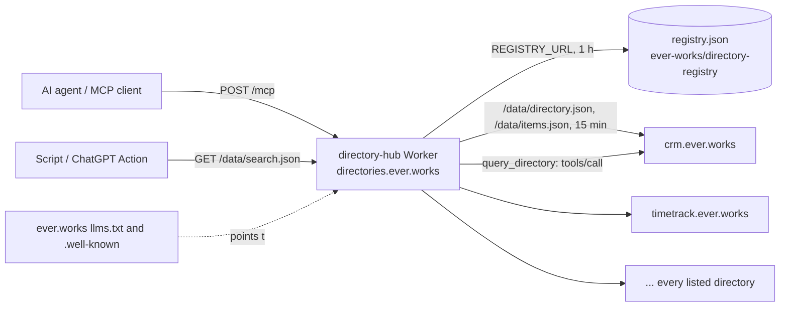

# Implementation Plan: Directory Hub

**Feature ID**: `directory-hub`
**Spec**: [`./spec.md`](./spec.md)
**Status**: `In Progress` (phase 1 live at `https://directories.ever.works` since 2026-11-21 17:3xZ)
**Last updated**: 2026-11-21

---

## 0. Where things stand (2026-11-21)

- 100 directory Works exist in the owner's tenant; a probe of their `<short>.ever.works` sites on 2026-11-21 15:00Z
  found **32 serving Contract v1** (`/data/directory.json` and `/.well-known/mcp.json` both `200`), **43 live on an
  older build** (`404` on `/data/`, being git-synced to template main) and **25 not deployed yet**. Older directories
  such as `timetrack.ever.works` (full template) do not serve Contract v1 until ever-works/directory-web-template#1181
  ships. The hub has to cope with directories at mixed versions, and will for a long time.
- Directory documents are small and already edge-cached: `crm.ever.works/data/items.json` is 56 KB for 90 items and is
  served with `Cache-Control: public, max-age=300, s-maxage=900` and an `ETag`.
- `mcp.ever.works` is the platform's own MCP server (`apps/mcp`, API-key guarded, tenant-scoped). It is not a place for
  anonymous public tools, and its hostname is taken.
- `ever.works` is the marketing site (`ever-works/ever-works-website`, Next.js behind Cloudflare). It serves no
  `llms.txt` and no `/.well-known/*` documents today.
- The platform has no notion of a "public" or "listed" Work: nothing in `Work` says a directory may be shown to anyone.

### Live check of the phase 0 code (2026-11-21, local `wrangler dev`, nothing deployed)

The Worker ran under workerd on a workstation with a scratch registry of the 100 directory hosts plus
`timetrack.ever.works`, reading the real sites (read-only GETs):

- 35 of 101 directories were available; the others were reported unavailable with a reason (old build: `HTTP 404`,
  not deployed yet: `network error`).
- Cold `list_directories` (101 `directory.json` reads) took 2.8 s; a cold `search_all` over the 35 available
  directories 1.4 s; warm searches 125–145 ms.
- `query_directory` (`crm`, `search_items`) returned a result byte-identical to calling `crm.ever.works/mcp` directly.
- "open source crm" ranks the CRM directory's open-source entries first; "email marketing" lands on transactional
  email (the email marketing directory was still on an old build).
- **The owner's two examples need data, not code**: `timetrack.ever.works` does not serve Contract v1 yet (full template,
  ever-works/directory-web-template#1181), and the scratch registry had no MCP-servers directory, so "time tracking
  tools" returned only tangential matches and "MCP servers for databases" returned nothing, with the hint. Both work in
  the unit tests with such directories present.
- The official MCP Inspector CLI connected over Streamable HTTP, listed the four tools and ran `search_all`.

### Phase 1 live (2026-11-21, owner's go)

- Worker `ever-works-directory-hub` deployed with `wrangler deploy` on the Workers Custom Domain
  `directories.ever.works` (no `workers.dev` or preview URL). The registry is
  [`ever-works/directory-registry`](https://github.com/ever-works/directory-registry) with 115 entries: the 100
  directories, `timetrack` and 14 older Works whose sites run on k8s. Among those is `awesome-mcp-servers`
  (`mcpserver.ever.works`, 6 items), but it runs a build without Contract v1.
- **Same-zone fetches work (plan §7 risk closed):** the directory sites are Workers on custom domains of the same zone,
  and the hub reads them with plain `fetch()`, no service binding. At 17:4xZ, 53 of 115 directories were available;
  42 answered `404` on `/data/directory.json` (older builds, including all 14 older Works and `timetrack`) and 20 had no
  site yet (`530`).
- Cold `directories.json` 1.7 s; warm `search_all` about 25–35 ms; `initialize` 190 ms.
- `query_directory` (`crm`, `search_items`) is byte-identical to calling `crm.ever.works/mcp` directly; `get_item`
  works. The MCP Inspector CLI runs `search_all` against the live hub. Every discovery document answers `200` with
  `Cache-Control: public, max-age=300, s-maxage=900`.
- "open source crm", "ai voice agents" and "email marketing" rank the right directory first. "time tracking software"
  and "MCP servers for databases" still wait for `timetrack` and `mcpserver` to serve Contract v1. Meanwhile
  `list_directories` with a query and `include_unavailable` names them, with the reason.

## 1. Options and the recommended default

### 1.1 Where the hub runs

| Option                                                            | For                                                                                                                                                                                           | Against                                                                                                                                                                                      |
| ----------------------------------------------------------------- | --------------------------------------------------------------------------------------------------------------------------------------------------------------------------------------------- | -------------------------------------------------------------------------------------------------------------------------------------------------------------------------------------------- |
| **A. Cloudflare Worker** (`apps/directory-hub`) ✅ recommended    | Runs on the same network and plan as the directory sites, so reads hit their edge cache; stateless; no cold-start server; abuse handled at the edge; no coupling to the platform release lane | First Worker in this monorepo (deploys with `wrangler`, not the k8s pipeline); needs a Cloudflare deploy token in CI                                                                         |
| B. Platform API / `apps/mcp` (`api.ever.works`, `mcp.ever.works`) | The platform knows every Work; one deploy pipeline                                                                                                                                            | `apps/mcp` is authenticated and tenant-scoped, and mixing anonymous tools into it blurs its trust model; fan-out from a k8s pod to 100+ sites per query; ships only through the release lane |
| C. A route in the ever.works website                              | Brand URL `ever.works/mcp` for free                                                                                                                                                           | Couples an agent API to the marketing site's CMS and deploys; Node server cold starts; that repo is shared with other sites' work                                                            |

The brand URL is not lost with A: a Workers route `ever.works/mcp*` on the apex zone can send just that path to the same
Worker later (phase 2), while the rest of `ever.works` keeps going to the website. That is a change on the marketing
site's zone, so it waits for the owner.

### 1.2 Public address

- **Recommended**: `https://directories.ever.works` for everything the hub serves (`/mcp`, `/data/*`, `/llms.txt`,
  `/.well-known/*`). The name says what it is, does not collide with any of the 100 directory names, and leaves
  `mcp.ever.works` to the platform.
- Alternatives: `hub.ever.works`; or `ever.works/mcp` as an extra route to the same Worker (phase 2).

### 1.3 How the hub finds directories

| Option                                                                                                         | Verdict                                                                                                                                                                                                                                              |
| -------------------------------------------------------------------------------------------------------------- | ---------------------------------------------------------------------------------------------------------------------------------------------------------------------------------------------------------------------------------------------------- |
| **R1. Directory Registry document in a catalog repo** (`ever-works/directory-registry`, `registry.json`) ✅ v1 | Follows ADR-014 (catalogs live in their own repos, never in the platform code). Reviewable, opt-in by pull request, works for directories on any host (custom domains, full template, Vercel). Holds identity only; metadata comes live.             |
| R2. The platform publishes opted-in Works (`GET /api/public/directories`) — phase 2                            | The long-term source: new directories appear without a pull request, and other tenants can opt in. Needs a forward-only migration (a "list in the hub" flag on Work), a settings toggle and a public endpoint. Merged with R1, R1 wins on conflicts. |
| R3. A "directory of directories" Work (items are directories) — optional                                       | Dogfoods the product and gives humans a browsable list plus a Submit page. The hub already accepts its `items.json` as a registry (FR-2), so switching later needs only a configuration change.                                                      |
| R4. Crawl each site's `/.well-known/mcp.json`                                                                  | Used, but as **validation** of registry entries (FR-4), not as the source: subdomains cannot be enumerated.                                                                                                                                          |
| R5. List Workers custom domains through the Cloudflare API                                                     | Rejected: puts an account token in a public service and lists every Worker, not only directories.                                                                                                                                                    |

How the registry reaches the hub: the Worker fetches `REGISTRY_URL` (the raw `registry.json` of the catalog repo) with a
one-hour edge cache and keeps the last good copy. Anonymous raw-file reads do not use the shared `evereq` REST quota.
If GitHub ever rate-limits those reads, the fallback is to publish `registry.json` as a static asset of the hub at
deploy time (same document, no code change, only `REGISTRY_URL` changes).

Registry document (Directory Registry v1):

```json
{
	"version": 1,
	"name": "Ever Works directories",
	"directories": [
		{
			"id": "crm",
			"url": "https://crm.ever.works",
			"topics": ["sales"],
			"aliases": ["customer relationship management"]
		},
		{ "id": "timetrack", "url": "https://timetrack.ever.works", "name": "Awesome Time Tracking" },
		{ "id": "old-thing", "url": "https://old.example.com", "listed": false }
	]
}
```

`id` defaults to the first hostname label; `name` and `description` are only fallbacks for directories that are not
available yet; `topics` and `aliases` feed the directory-aware ranking; `listed: false` hides an entry without
deleting it.

### 1.4 How searching across directories works

| Option                                                                                                     | Verdict                                                                                                                                       |
| ---------------------------------------------------------------------------------------------------------- | --------------------------------------------------------------------------------------------------------------------------------------------- |
| **S1. Merged index from each directory's static read API** (`/data/directory.json`, `/data/items.json`) ✅ | One edge-cached GET per directory per refresh; works for directories without `/mcp`; one ranking across all items, so results are comparable. |
| S2. Fan out every query to each directory's `/mcp` `search_items`                                          | Rejected for `search_all`: N Worker invocations per query, scores from different directories cannot be merged, one slow site delays all.      |

`query_directory` does proxy to one directory's `/mcp`, because there the goal is that directory's exact answer.

## 2. Architecture



Per request the Worker:

1. resolves the registry (isolate memory, then edge cache, then `REGISTRY_URL`);
2. resolves each directory's `directory.json` and, for searches, `items.json`, six fetches at a time, 4 s each;
3. answers from memory: ranking, filtering and capping are local.

### Code layout (`apps/directory-hub`, framework-free TypeScript, no runtime dependencies)

| File               | Role                                                                                                       |
| ------------------ | ---------------------------------------------------------------------------------------------------------- |
| `src/contract.ts`  | Contract v1 types and the shared text helpers (`normalizeText`, `tokenize`, `taxonomySlug`, item scoring). |
| `src/registry.ts`  | Parses and validates a registry document (Registry v1 or Contract v1 `items.json`).                        |
| `src/loader.ts`    | Bounded, cached, size-capped fetching of registry and directory documents; availability; last known good.  |
| `src/search.ts`    | Directory-aware ranking for `search_all` and `list_directories`.                                           |
| `src/tools.ts`     | Hub Contract v1 tool definitions and their handlers.                                                       |
| `src/mcp.ts`       | Streamable HTTP JSON-RPC transport with the Contract v1 rules.                                             |
| `src/discovery.ts` | `llms.txt`, MCP server card, RFC 9727 API catalog, OpenAPI 3.1.                                            |
| `src/app.ts`       | Router for `/mcp`, the REST twins and the discovery documents.                                             |
| `src/worker.ts`    | Worker entry: only the default export (workerd treats named exports as entrypoints).                       |

`contract.ts` re-implements the few Contract v1 helpers instead of importing `@ever-works/agent-api`, which is a private
workspace package of the minimal template repository. The ranking weights are part of the contract, so the copy is
pinned by tests that use the same expectations. Publishing `@ever-works/agent-api` to npm would remove the copy
(phase 2 task).

## 3. Caching

| What                           | Where                                | TTL                         | On failure                                                |
| ------------------------------ | ------------------------------------ | --------------------------- | --------------------------------------------------------- |
| Registry                       | isolate memory, edge (`cf.cacheTtl`) | 10 min memory, 1 h edge     | keep last good copy; cold with no copy → error            |
| `directory.json`, `items.json` | isolate memory, edge (`cf.cacheTtl`) | 10 min memory, 15 min edge  | keep last good copy and mark it `stale`; else unavailable |
| `items/{slug}.json`            | edge only                            | 15 min                      | tool error                                                |
| Hub `/data/*.json`, discovery  | response `Cache-Control`             | `max-age=300, s-maxage=900` | —                                                         |
| `/mcp`                         | not cached (`no-store`)              | —                           | —                                                         |

Concurrent refreshes of the same document share one in-flight promise, so a burst of calls on a cold isolate fetches
each document once.

**Phase 2 (only if cold-isolate latency or memory becomes a problem):** a Workers Cron Trigger every 15 minutes builds
one compact merged index, conditional-GETs each `items.json` with its `ETag`, and stores it in Workers KV (one write per
run, ~100 writes a day). Requests then read one KV value instead of N documents.

## 4. Hub Contract v1 — tools

All tools are `readOnlyHint: true`, `idempotentHint: true`, `destructiveHint: false`. Results are returned as
`structuredContent` and as JSON text, like Contract v1.

| Tool               | Input                                                                                                                                                       | Result                                                                                                                                                |
| ------------------ | ----------------------------------------------------------------------------------------------------------------------------------------------------------- | ----------------------------------------------------------------------------------------------------------------------------------------------------- |
| `list_directories` | `{ query?: string; include_unavailable?: boolean; offset?: number; limit?: number (1-200, default 50) }`                                                    | `{ total, offset, limit, directories: DirectorySummary[], unavailable_count, unavailable? }`, ranked by relevance when `query` is set, else by name   |
| `search_all`       | `{ query: string; directories?: string[]; category?: string; tag?: string; limit?: number (1-50, default 20); per_directory?: number (1-50, default 10) }`  | `{ query, total, directories_searched, matched_directories: { id, name, url, hits, topic_match }[], items: HubItem[], unavailable: string[], hint? }` |
| `get_item`         | `{ directory: string; slug: string }`                                                                                                                       | Contract v1 `ItemDetail` plus `directory: { id, name, url }`                                                                                          |
| `query_directory`  | `{ directory: string; tool: 'get_directory_info' \| 'search_items' \| 'list_items' \| 'get_item' \| 'list_categories' \| 'list_tags'; arguments?: object }` | Exactly the directory's own tool result                                                                                                               |

```ts
interface DirectorySummary {
	id: string;
	name: string;
	description: string;
	url: string; // directory origin
	mcp: string | null; // its own /mcp URL
	llms: string; // its llms.txt
	item_name: string;
	items_name: string;
	items: number;
	categories: number;
	updated_at: string | null;
	topics: string[];
	stale: boolean; // served from the last good copy
}

interface UnavailableDirectory {
	id: string;
	url: string;
	name: string | null;
	reason: string;
}

interface HubItem extends ItemSummary {
	directory: { id: string; name: string; url: string };
	score: number;
}
```

`directory` arguments accept a registry id (`crm`), a directory hostname (`crm.ever.works`) or its origin
(`https://crm.ever.works`) — always resolved against the registry; anything that does not resolve fails without a fetch.

`list_directories` returns `unavailable_count` always and the `unavailable` list only with `include_unavailable: true`,
so the usual answer is not padded with directories that are still being upgraded.

REST twins: `GET /data/directories.json` (= `list_directories` with `include_unavailable: true`, no paging) and
`GET /data/search.json?q=…&directories=a,b&category=…&tag=…&limit=…&per_directory=…` (= `search_all`).

## 5. Directory-aware ranking (`search_all`)

1. Tokenize the query with Contract v1 `tokenize`. Tokens in a short filler list (`find`, `list`, `show`, `best`, `top`,
   `tools`, `software`, `apps`, `platforms`, `services`, `for`, `the`, `and`, `of`, `with`, …) are **optional**; all
   others are **required**. When every token is filler, every token is required. One-letter tokens are dropped unless
   nothing longer is left, and at most 12 tokens are used (an anonymous query must not score hundreds of words against
   every item).
2. A token matches text when the text contains the token or its simple singular (`servers` → `server`,
   `companies` → `company`).
3. **Directory score** per token: `+6` when a word of the directory name starts with it (the word "awesome" is
   ignored), `+4` when a word of a topic or alias starts with it, `+3` when the id or one of its `-` parts starts with
   it, `+1` when the description contains it. Word prefixes, not substrings: "ai" must not match an "email" topic. Only the name, topic, alias and id matches are **strong**: a word found only in the directory's
   description adds score but does not count as matched for its items (otherwise "open source crm" would return every
   CRM whose directory description mentions open source).
4. **Item score** per token: Contract v1 weights (`+8` whole name, `+5` name word prefix, `+3` name contains, `+2`
   category/tag, `+1` description).
5. An item qualifies when **every required token** matches its own fields or is a strong match of its directory.
6. Item rank = Σ required (item score + 0.75 × directory score) + 0.5 × Σ optional (item score + directory score),
   plus `10` when the whole query equals the item name and `0.5` when the item is featured. Ties: directory topic
   match first, then item name.
7. Keep at most `per_directory` items per directory, then the top `limit`.

So "time tracking tools" matches the time tracking directory by name (both required tokens), puts its featured items
first, and still finds a "time tracking" add-on listed in a project management directory, lower down. "MCP servers for
databases" needs "databases" from the item itself when the directory only covers "MCP servers".

`list_directories` with a query ranks directories by directory score and, when no directory name matches, by how many of
their items match, so "which directories cover MCP?" still answers.

## 6. Rollout

| Phase | What                                                                                                                                                                                                                                                                                   | Who / gate                                            |
| ----- | -------------------------------------------------------------------------------------------------------------------------------------------------------------------------------------------------------------------------------------------------------------------------------------- | ----------------------------------------------------- |
| 0     | This spec, ADR-019 and `apps/directory-hub` with tests. Nothing deployed.                                                                                                                                                                                                              | PR review                                             |
| 1     | Create `ever-works/directory-registry` seeded with the 100 directories plus older ones (`timetrack`, …); deploy the Worker on `directories.ever.works`; ever.works `llms.txt` and `/.well-known/mcp.json` pointers (ever-works-website PR); live checks with MCP Inspector and Claude. | Owner's go for new public infrastructure; board claim |
| 2     | Directory-side pointer (Contract v1.1 `network` field and an `llms.txt` line, both templates); platform opt-in flag and `GET /api/public/directories`; optional `ever.works/mcp` route; Cron + KV index if needed; publish `@ever-works/agent-api`.                                    | Owner's go per item                                   |
| 3     | List the hub in the official MCP Registry (`server.json`, remote `streamable-http`), Smithery and other catalogs; optional semantic search (Vectorize); optional human "all directories" page (design rule applies).                                                                   | Owner's go (external publishing)                      |

Deploying is `npx wrangler deploy` from `apps/directory-hub` with a Cloudflare token scoped to Workers on the
`ever.works` zone, or the manual workflow `.github/workflows/deploy-directory-hub.yml` (GitHub-hosted runner, needs the
`DIRECTORY_HUB_CLOUDFLARE_TOKEN` and `CLOUDFLARE_ACCOUNT_ID` secrets in the `directory-hub` environment, whose
deployment branches should be limited to `main`). Each deploy follows the board rule.
Rollback: `wrangler rollback` to the previous version, or remove the custom domain to take the hub offline (the
directories are untouched; the hub only reads them).

## 7. Risks

| Risk                                                                    | Mitigation                                                                                                                                                                                       |
| ----------------------------------------------------------------------- | ------------------------------------------------------------------------------------------------------------------------------------------------------------------------------------------------ |
| A Worker fetching sibling Workers on the same zone hits a platform rule | Closed at the phase 1 deploy: plain `fetch()` reaches them, because the directories are on Workers Custom Domains (not routes). Should a directory move to a route, use a service binding to it. |
| Cold isolate fans out 200 requests                                      | Six at a time, 4 s timeout, shared in-flight promises, edge cache; phase 2 KV index.                                                                                                             |
| Third-party text in items steers agents (prompt injection)              | Returned as data only; server instructions say item text is untrusted; no tool ever acts on item content.                                                                                        |
| SSRF through `directory` arguments or a directory's own documents       | Only registry origins are fetched; endpoints read from a `directory.json` must stay on that directory's origin.                                                                                  |
| Hub ranking drifts from Contract v1                                     | `query_directory` proxies the directory itself; the shared weights are pinned by tests.                                                                                                          |
| Registry fetch blocked or rate-limited                                  | Last known good copy; fallback to a deploy-time static asset (§1.3).                                                                                                                             |
